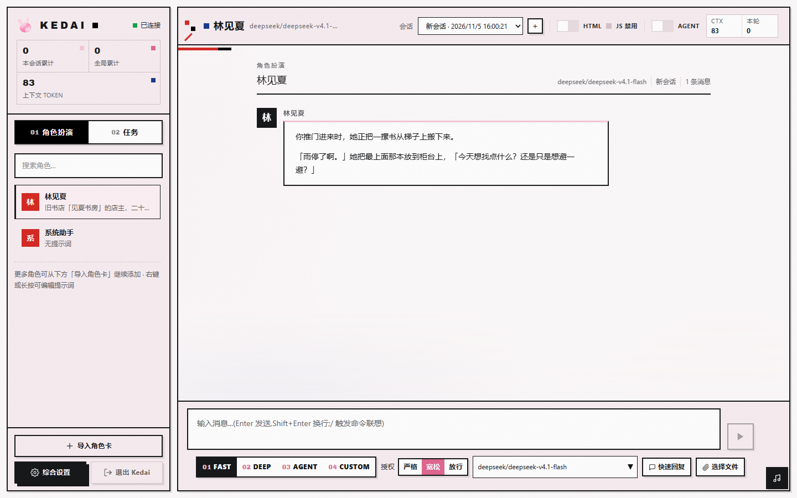
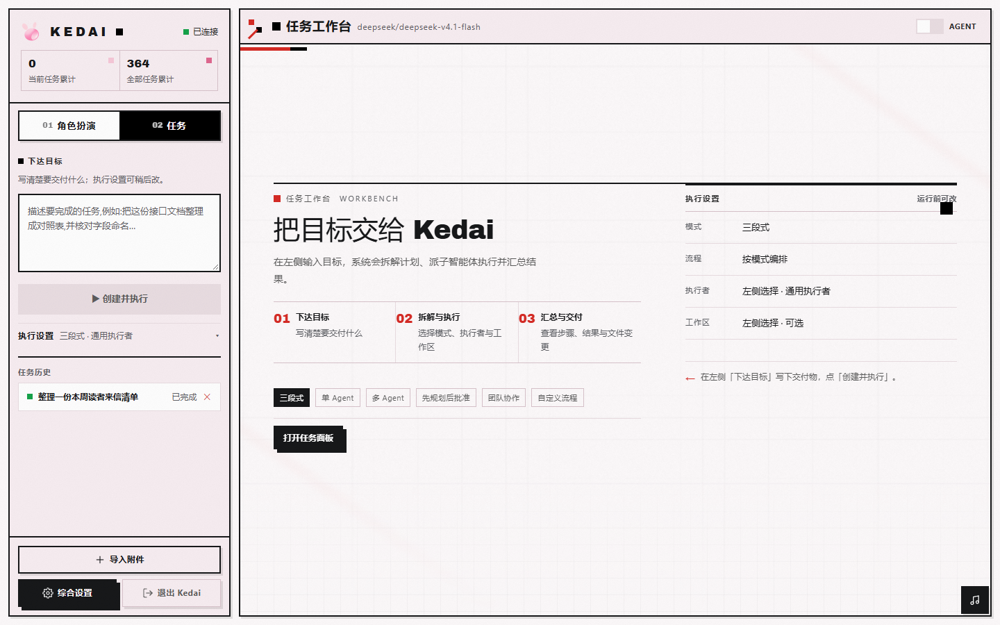

<div align="center">


# KedaiAgent

**一款软件，一键出发。**

把大模型从「聊天框」变成能干活的本地智能体 harness。

[](https://github.com/Sata1949/kedai/releases/latest)
[](LICENSE)
[](#下载)
[](https://github.com/Sata1949/kedai/actions/workflows/ci.yml)
[](server-rs/)
[](web/)
[](https://github.com/Sata1949/kedai/stargazers)

[下载](#下载) · [功能](#功能) · [快速开始](#快速开始) · [技术栈](#技术栈) · [文档](#文档) · [参与贡献](#参与贡献)

</div>

| 角色扮演 · 文学创作 | 任务工作台 |
|:---:|:---:|
|  |  |
| 角色卡 / 世界书 / 提示词楼层 / 长篇创作 | 下达目标 → 拆解计划 → 子智能体执行 → 交付校验 |

---

## 这是什么

**KedaiAgent** 是一个**本地运行的通用 LLM 智能体 harness**——双顶层模式（角色扮演 / 文学创作会话 + 任务工作台），内置 Agent 引擎（计划 → 执行 → 反思）与工具 / 授权层；垂直能力以**官方能力包**形态交付（默认关、显式启用）。SillyTavern 生态原生兼容落在解析层。

两个模式**平级**，共享同一套 Agent 引擎、连接器、工具与授权层：

| 模式 | 面向 | 你能做什么 |
|---|---|---|
| 🎭 **角色扮演（文学创作）** | 创作与沉浸式交互 | 导入角色卡与世界书，按设定的文风、规则和变量持续创作；支持酒馆预设、正则脚本、HTML 状态栏与 EJS / MVU 兼容 |
| 🗂️ **任务工作台** | 让模型真的干活 | 下发一个目标，自动拆解计划、派子智能体执行、汇总成果并做交付校验；支持附件、工作区、六种编排模式和全程轨迹 |

> **本地优先**：聊天记录、角色卡、API Key 全部留在自己的机器上。除你自行配置的远程 LLM 后端外，不向任何第三方上传数据。

## 功能

### 🎭 角色扮演与 SillyTavern 兼容
- **角色卡**：V2 / V3 规范（`.png` tEXt 内嵌或独立 `.json`），未知字段无损保留。
- **世界书**：独立 JSON 或角色卡内嵌 `character_book`，按关键词或正则命中注入；常驻条目、扫描窗口与插入深度可调。
- **提示词楼层**：仿 SillyTavern Prompt Manager 的楼层系统，可拖拽排序、逐层启停、按角色正文注入。
- **正则脚本与消息 HTML**：全局 / 卡级正则脚本；AI 回复按白名单渲染折叠块、状态栏等结构，脚本与事件属性会被剥除。
- **酒馆生态兼容**：EJS 模板、MVU 变量树、`<UpdateVariable><JSONPatch>` 输出协议、酒馆预设导入 / 导出。

### 🗂️ 任务工作台
- **六种执行模式**：三段式（legacy）/ 单 Agent / 多 Agent / 先规划后批准 / 团队协作 / 自定义流程。
- **任务附件**：任意文件可多选交给任务（单任务 10 个、单文件 25MB），落在任务工作目录内，目标里自动列出相对路径。
- **执行过程三档显示**：「步骤 / 全消息 / 压缩」——只看计划时间线，或逐条查看思考、工具调用、工具结果与步骤产出。
- **交付与可靠性**：规划器声明文件归属、首写者认领、交付校验（必需 / 已生成 / 缺失）、占位内容体检、上游重试与团队预算分摊。
- **会话延续**：终态追加指令（追加 / 重写）、部分成果保留、断线后的轨迹补拉。

### 🤖 Agent 引擎与工具
- **四种对话档位**：`fast`（单步直出）/ `deep`（计划 → 执行 → 反思）/ `agent`（工具自循环）/ `custom`（自定义流程）。
- **工具循环**：OpenAI Function Calling 全链路，内置文件读写、搜索、计算、记忆、命令执行等工具；推理链与工具调用经 SSE 实时推送。
- **三档授权**：严格 / 宽松 / 放行，按「操作类型 × 路径区域」判定；高风险命令逐条确认，授权面板可查看与撤销。
- **技能、插件与 MCP**：技能渐进披露、白名单脚本工具插件、MCP stdio 客户端；工具行会标明来源。
- **官方能力包**：编码 / 文学 / 视觉与截图，默认关、显式启用，不侵入内核架构。

### 🧠 上下文工程与记忆
- **缓存感知压缩**：每轮 usage 落库，前缀分层 + 阶梯压缩；缓存命中率、费用估算与水位诊断可在「优化」面板查看。
- **可逆投影与 LLM 摘要**：先做零成本 snip（陈旧工具结果压占位符），再按水位做摘要；同会话公共前缀逐字节稳定。
- **跨会话记忆**：会话历史蒸馏为结构化记忆条目，按使用频率与近期性衰减精选注入；支持向量化语义召回。

### 🖥️ 本地、跨端与界面
- **Windows 便携版**：Tauri 2 桌面壳 + 进程内 Rust 服务，解压即用，无需 Node.js / Rust。
- **Android**：四 ABI 通用 APK，`minSdk 30`；桌面与移动共用同一套后端能力。
- **双主题**：默认主题 + 彩窗主题「石室与光」；角色扮演「编辑部」空态、任务台两栏空态、状态矩阵与成果卡。
- **隐私**：SQLite + 本地文件；Windows 用 DPAPI、Android 用 Keystore 加密密钥，绝不明文回传前端。

## 下载

### Windows 便携版

**[前往 Releases 下载最新版](https://github.com/Sata1949/kedai/releases/latest)**

- 文件：`Kedai-<版本>-win64-portable.7z`
- 解压后运行 `Kedai.exe`；整个目录可复制给其他机器，不需要安装。
- 系统需要 Microsoft Edge WebView2 Runtime（Windows 10/11 通常已内置）。
- 产物**未做 Authenticode 代码签名**，从网络下载后首次运行可能触发 SmartScreen：点「更多信息」→「仍要运行」即可。产物哈希与构建指纹见 [docs/契约-协议与配置.md](docs/契约-协议与配置.md)。

### Android

**[前往 Releases 下载最新版](https://github.com/Sata1949/kedai/releases/latest)**

- 文件：`Kedai-<版本>-universal-release.apk`
- 通用包包含 `arm64-v8a` / `armeabi-v7a` / `x86` / `x86_64`，`minSdk 30`。
- 使用发布密钥自签，覆盖安装前请确认签名一致；安装时按系统提示允许「安装未知应用」。

### 版本后缀

| 后缀 | 含义 |
|---|---|
| `Alpha` | **测试版**：最新功能，可能存在较严重的问题 |
| `Beta` | **预览版**：已证实的实用功能与合理修复 |
| 大写字母（`A` / `B` / …） | **修复版**：仅用于稳定版的恶性问题修复 |
| 无后缀 | **稳定版**：推荐普通用户使用 |

## 快速开始

### 开发模式（前后端分离）

要求：Node.js ≥ 18（npm）、Rust 工具链（`cargo` / `rustup`）。

```powershell
# 1. 安装前端依赖（按 lockfile 确定性安装）
npm ci

# 2. 编译后端（debug）
cd server-rs
cargo build

# 3. 两个终端分别启动
#    终端 A：后端，监听 127.0.0.1:3001
cargo run -p kedai-server
#    终端 B：前端 HMR，监听 http://localhost:5173
npm run dev -w web
```

> 前端 HMR 路径下，改界面即时热更新；Rust 服务默认使用编译期内嵌的 `web/dist`，设置 `KEDAI_WEB_DIST` 指向磁盘目录时才用磁盘版覆盖。

### 一条命令持续增量编译

```powershell
npm run watch        # 监听前后端源码，保留 cargo target
.\start.ps1          # 自动选择最新 debug 产物并启动
```

### 全量构建（版本更新 / 交付前）

```powershell
.\build.ps1          # 前端 + Rust release + Windows 便携版 + 构建指纹
```

> 日常开发用 `npm run watch`（增量）；**版本号更新后、发布/交付前**用 `.\build.ps1`（全量双端同步，含门禁与指纹）。`.\build.ps1 -TestOnly` 只产测试版，不刷新便携版。详见 [MAINTENANCE.md](MAINTENANCE.md) §4。

### 配置

首次启动后，在「综合设置 → 连接与模型 → API 连接」填写 BASE URL / API KEY / MODEL；也可复制 `.env.example` 为 `.env` 配置 `OPENAI_BASE_URL` / `OPENAI_API_KEY`。

未配置 Key 也能体验：将 `CONNECTOR` 设为 `mock`（或让默认配置回退）即可使用演示模式。

### 三分钟试跑

1. 打开应用，点左栏「导入角色卡」，选择 `.png` 或 `.json` 卡片。
2. 选中角色，输入消息发送（Fast 模式）。
3. 切到 **Deep** 模式，输入「帮我算 12*34」→ 观察 Agent 面板中的工具调用与推理链。
4. 切到 **任务**，在「下达目标」写一个小目标，创建并执行，查看计划步骤、执行轨迹与成果。

## 技术栈

| 层 | 选型 |
|---|---|
| 桌面壳 | **Tauri 2**（窗口加载本地服务，可选 NSIS 安装包） |
| 前端 | Vue 3 + Vite + Tailwind CSS v4 + Pinia |
| 后端 | **Rust + axum + tokio** |
| 数据库 | SQLite（rusqlite，bundled） |
| 流式 | SSE（Server-Sent Events） |
| Token 计数 | tiktoken-rs（按模型自动选分词器） |
| 测试 | cargo test（单元 + API 集成）+ Vitest（前端） |

```
kedai/
├── server-rs/       # Rust 后端：api / agents / services / tools / parsing / models
├── web/             # Vue 3 前端：stores / components / composables / mvu
├── src-tauri/       # Tauri 2 桌面壳与 Android 工程
├── launcher/        # 图形启动器（项目根 Kedai.exe）
├── docs/            # 功能、契约、计划、经验、遗留与变更史
├── examples/        # 技能 / 工具插件 / 预设示例
├── build.ps1        # 全量构建（前端 + release + 便携版）
└── MAINTENANCE.md   # 架构、构建、API、数据库与踩坑记录
```

## 文档

| 文档 | 内容 |
|---|---|
| [docs/功能.md](docs/功能.md) | 已实现能力总览（角色扮演 / 任务 / 工具 / 上下文 / 记忆） |
| [docs/契约.md](docs/契约.md) | API、协议、配置与发布契约（字段与错误码的权威来源） |
| [docs/计划.md](docs/计划.md) | 未启动 / 待做的可执行计划 |
| [docs/遗留.md](docs/遗留.md) | 已知缺陷、设计边界与知情接受项 |
| [docs/经验.md](docs/经验.md) | 踩坑与工程经验 |
| [docs/功能-变更史.md](docs/功能-变更史.md) | 逐轮已实现条目与验证证据 |
| [MAINTENANCE.md](MAINTENANCE.md) | 面向维护者的架构、构建、启动与数据库说明 |
| [examples/README.md](examples/README.md) | 技能、工具插件与预设模板 |

## 测试与门禁

```powershell
# 后端：单元测试 + API 集成测试
cargo test --manifest-path server-rs/Cargo.toml -j 8

# 前端：单测 + 类型检查
npm test -w web
npm run typecheck -w web

# 仓库根：一键全量检查（阶段清单见 MAINTENANCE.md §2）
npm run check
```

> **验收基准**：所有批次以**真实模型实测**为唯一验收口径，mock / 单测只作回归网。凭据只存本机仓外，不写入仓库（本仓为公开仓）——口径见 [AGENTS.md](AGENTS.md) 的「真实模型实测」节。

## Roadmap

- [x] 世界书按关键词 / 正则注入
- [x] Tauri 桌面化（窗口 + 便携版 + 品牌图标）
- [x] 智能上下文压缩（可逆投影 + LLM 摘要 + 缓存感知）
- [x] 跨会话记忆蒸馏与向量化召回
- [x] 技能渐进披露与子代理调度守卫
- [x] 任务工作台六模式 + 事件 SSE + 双模式提示词隔离
- [x] 三档授权与高风险命令确认
- [x] 任务附件、执行过程三档显示、交付校验
- [ ] Oobabooga / KoboldAI 连接器适配
- [ ] 工具执行沙箱隔离
- [ ] 知识库向量检索工具

## 参与贡献

- **问题 / 建议**：优先开 [Issue](https://github.com/Sata1949/kedai/issues)，附复现步骤、版本号与日志。
- **代码 / 文档**：从 `main` 开功能分支 → 提交 PR → CI（`check` / `check-ubuntu`）通过后合并；合并后删除临时分支。
- **开发约定**：先读 [AGENTS.md](AGENTS.md) 与 [MAINTENANCE.md](MAINTENANCE.md)；改核心行为先写失败测试，再做最小实现。
- **安全**：不要在 Issue / PR 中粘贴聊天正文、API Key 或本地真实数据。

## 致谢

- **mvu 变量系统**（`web/src/mvu/` 与后端 `parsing/assistant/`）是 **MagVarUpdate** 的协议兼容实现：协议约定与全局脚本 API 源自 [MagicalAstrogy/MagVarUpdate](https://github.com/MagicalAstrogy/MagVarUpdate)（MIT License）。KedaiAgent 为独立实现，不包含原版代码、不依赖其运行时。
- 酒馆助手（SillyTavern-Assistant）兼容层的 `<UpdateVariable><JSONPatch>` 输出协议参考 SillyTavern 社区插件生态的公开约定。
- SillyTavern 是角色卡 / 世界书 / 提示词系统的事实标准之一；本项目仅在解析与交互层做兼容，不包含其代码。

## 许可与声明

[MIT](LICENSE) © 2026 Sata1949

- 本应用**免费分发**，**不存在任何针对软件本体的收费项目**。**若你是花钱买的，那说明你上当受骗了。**
- 除用户自行配置的远程 LLM 后端外，**数据不上传任何第三方**；聊天记录、角色卡、API Key 全部只存在你自己的机器上。
